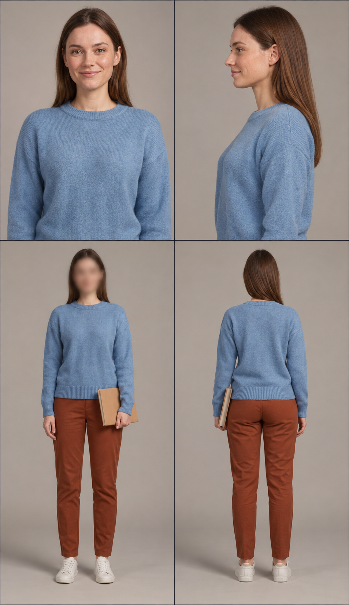

# 人物四宫格 / Character Four Grid

一张全身照，生成同一人物的正面半身、侧面半身、正面全身与背面全身四宫格。保留原图动作、背景、服装和光照，第三格默认模糊脸部。

这是与平台和模型无关的 Markdown 技能包。核心指令不依赖 Codex 或特定生图工具；agent 使用自己已连接的图片生成/编辑能力。

## 复制链接交给 agent

将下面这句话发给支持安装技能的 agent：

```text
请从 https://github.com/HuHana77/create-character-four-grid 安装“人物四宫格”技能。先阅读 README.md，按你当前平台支持的方式安装，保留排版参考图，并检查你是否能使用参考图生图。不要为此新增付费服务。
```

安装后上传一张全身照，再说：

```text
使用人物四宫格技能生成，保留原图动作和背景，第三格脸部模糊。
```

## 给安装 agent 的说明

1. 仅在用户要求安装本技能时执行安装。读取本仓库的 `SKILL.md`，取得 `references/layout-reference.png`；两者都必须保留，不只复制提示词。
2. 优先使用宿主的技能安装器。没有安装器时，依据当前宿主文档、配置或已有技能目录确定安装位置，将本仓库保存为独立的 `create-character-four-grid/` 目录。不要假定所有 agent 都使用 Codex 路径，不覆盖同名旧技能而不检查差异。
3. 核心文件为 `SKILL.md` 和 `references/layout-reference.png`。`agents/openai.yaml` 是可选显示元数据，其他宿主可忽略。不要为了加载本技能改写用户的全局 agent 指令或切换模型。
4. 检查技能已能被发现、参考图能读取，并确认宿主能查看用户图片且支持参考图生图或图片编辑。仅检查能力，不在安装时自动发起收费生成。报告实际安装位置和能力缺口。
5. 如果没有技能持久化或文件写入能力，明确告知不能持久安装；可以在当前会话加载 `SKILL.md` 和参考图临时使用。没有读取 GitHub 的能力时，让用户提供仓库 ZIP 或核心文件，不假称已安装。
6. 私有仓库需要用户拥有访问权限；公开仓库可免 GitHub 登录读取。不要索取用户的访问令牌到聊天里。

## 能力与兼容边界

- 需要图片查看能力，以及支持参考图的图片生成或编辑工具。只有文生图能力时，无法可靠保留原人物。
- 同时支持人物图和排版图作为输入时，构图参照最完整。工具只支持一张参考时，优先传人物照，通过技能中的数值规范描述布局。
- 是否支持自动安装、自然语言调用、可选画布比例以及最终生成质量，取决于宿主。未对所有 agent 或生图模型逐一测试，不承诺所有平台都能一键安装。
- 核心技能不需要 Python、Node 或指定厂商的 API key；生成工具本身可能需要宿主账号、额度或已有授权。

## 保留原图动作

第一格是原动作的上半身近景，第三格保持原图全身动作并模糊脸部。侧面和背面是同一姿态的转视角，不重新摆姿势。排版参考图仅决定格子比例和取景，不能覆盖原图动作。

例如原图交叉抱臂、单腿弯曲、脚跟抬起时，全身格必须保留这些特征，不能改成垂手、双腿并拢直立。正面姿态优先复用原图；隐藏的侧背细节由模型合理补全，精度仍受工具能力影响。

旧安装请更新完整技能包，并让 agent 重新加载 `SKILL.md`，以免继续沿用旧版站姿指令。

## 构图

整体宽高比约 26:45，上下排约 40:60；上排为紧凑的头顶至腰部取景，人物大小以随附参考图为准。排版参考只控制构图，不提供人物身份、服装或背景。

| 左上 | 右上 |
| --- | --- |
| 正面半身，脸部清晰 | 侧面半身，脸部清晰 |
| **左下：正面全身，脸部模糊** | **右下：背面全身** |



具体生成规范见 [SKILL.md](SKILL.md)。侧面与背面细节由单张照片合理生成。
